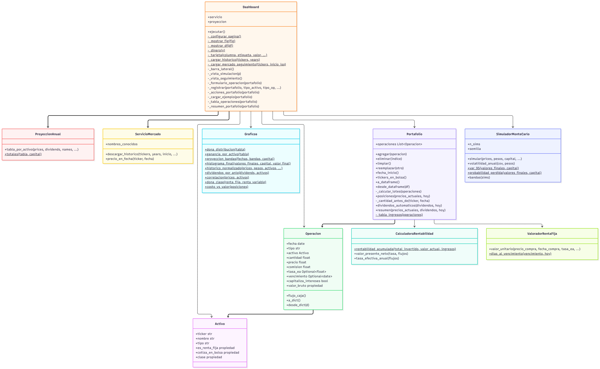

# Arquitectura

El código se divide en **clases, una por archivo**, dentro del paquete `portafolio_app/`. `main.py` es el archivo
principal: crea el `Dashboard`, que carga y coordina las demás clases.

> En la wiki de GitHub sube `docs/diagrama_uml.png` al repositorio wiki (o usa la URL raw del archivo del repositorio principal).
| Clase | Responsabilidad |
|---|---|
| `Activo` | Instrumento (acción, ETF, bono, CDT, TES) y su clase: renta fija / variable. |
| `Operacion` | Compra, venta, dividendo, interés o pago de capital, con comisión. Calcula su flujo de caja. |
| `ValoradorRentaFija` | Valoración por devengo de CDT/TES/bonos con tasa E.A. y vencimiento. |
| `CalculadoraRentabilidad` | Rentabilidad acumulada y E.A. (XIRR por bisección). |
| `Portafolio` | Libro de operaciones, posiciones (FIFO), dividendos automáticos y resumen consolidado. |
| `ServicioMercado` | Descarga de precios y dividendos con yfinance. |
| `ProyeccionAnual` | Rendimiento esperado a 1 año (CAGR de precio + dividendos 12 meses). |
| `SimuladorMonteCarlo` | Simulación multivariada, VaR 95 %, volatilidad. |
| `Graficos` | Figuras de Plotly. |
| `Dashboard` | Interfaz Streamlit (dos vistas). |

Regenerar el diagrama: `python docs/generar_uml.py`.
