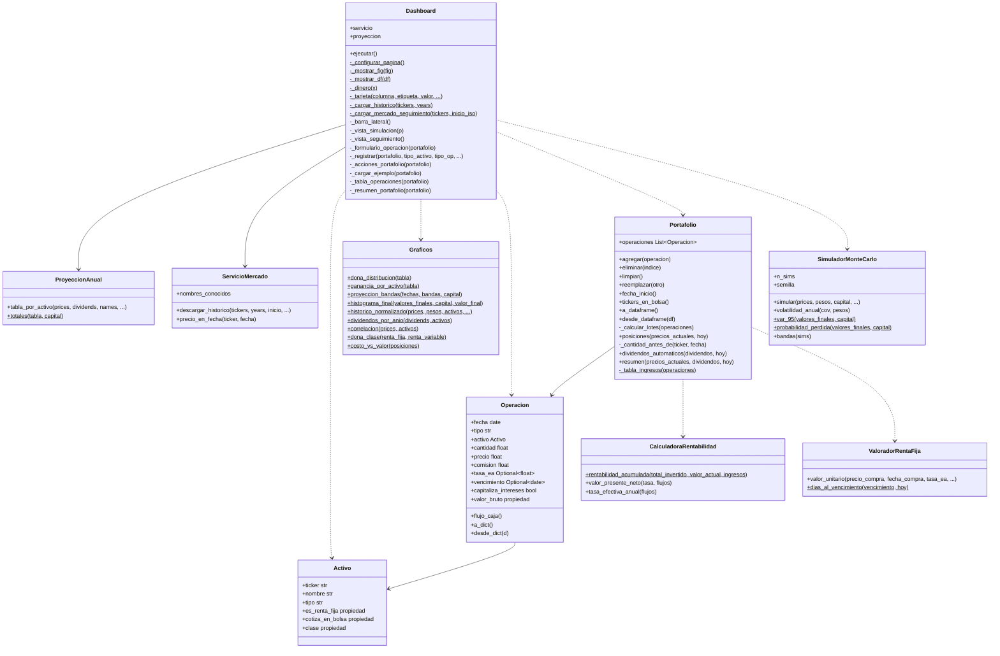

# ★ Seguimiento y Simulación de Portafolio de Inversión

Aplicación en **Python + Streamlit + Plotly + yfinance** para registrar, monitorear y evaluar un portafolio de
**renta variable** (acciones, ETF) y **renta fija** (CDT, TES, bonos), con una simulación a 1 año del portafolio.


## ★ Funcionalidades

| Vista | Qué hace |
|---|---|
| **💼 Seguimiento de portafolio** | Registra compras, ventas, dividendos, intereses y pagos de capital (fecha, cantidad, precio/valor y **comisión del broker**). Valora acciones/ETF con precios de mercado (yfinance) y CDT/TES/bonos por sus condiciones contractuales (tasa E.A., plazo, vencimiento). Calcula **valor total invertido, valor actual, rentabilidad acumulada, rentabilidad efectiva anual (E.A.)** y la **distribución renta fija vs. renta variable**. Importa/exporta CSV. |
| **🔮 Simulación a 1 año** | Proyección del rendimiento esperado (precio + dividendos), tarjetas de métricas, dona de distribución, histórico comparativo y simulación Monte Carlo.

## ★ Estructura del proyecto 

```
main.py                              # Archivo principal: carga el Dashboard (streamlit run main.py)
portafolio_app/
├── activo.py                        # class Activo
├── operacion.py                     # class Operacion
├── valorador_renta_fija.py          # class ValoradorRentaFija
├── calculadora_rentabilidad.py      # class CalculadoraRentabilidad
├── portafolio.py                    # class Portafolio
├── servicio_mercado.py              # class ServicioMercado
├── proyeccion_anual.py              # class ProyeccionAnual
├── simulador_montecarlo.py          # class SimuladorMonteCarlo
├── graficos.py                      # class Graficos
└── dashboard.py                     # class Dashboard

## ★ Instalación y ejecución

```bash
git clone <URL-DEL-REPOSITORIO>
cd seguimiento_portafolio
python -m venv venv
source venv/bin/activate            # Windows: venv\Scripts\activate
pip install -r requirements.txt
streamlit run main.py
```

Se abre en `http://localhost:8501`. Requiere conexión a internet (Yahoo Finance).

## ★ Cómo se calcula

- **Total invertido** = Σ (cantidad × precio + comisión) de las compras.
- **Valor actual** = acciones/ETF: cantidad × último precio de cierre; CDT/TES/bonos:
  `valor = precio × (1 + tasa_EA)^(días/365)` hasta el vencimiento (devengo).
- **Dividendos de acciones/ETF**: automáticos desde yfinance = dividendo por acción × unidades en poder
  *antes* de la fecha ex-dividendo. **Intereses** de renta fija: se registran como operación.
- **Rentabilidad acumulada** = (valor actual + ventas netas + dividendos/intereses − total invertido) / total invertido.
- **Rentabilidad efectiva anual (E.A.)** = TIR con fechas (XIRR) de todos los flujos: compras y comisiones (−),
  ventas, dividendos, intereses (+) y valor actual del portafolio hoy (+).
- **Posiciones**: método FIFO para ventas parciales.

Detalle en la [wiki](docs/wiki/Calculos-Financieros.md).

## ★ Diagrama UML



## ★ Pruebas

```bash
python -m unittest discover -s tests -v
```

## ⚠️ Limitaciones

- Todos los valores deben registrarse en **una sola moneda** (no hay conversión USD/COP).
- CDT/TES/bonos se valoran por devengo a su tasa E.A.; no se usa precio de mercado secundario.
- No incluye impuestos ni retenciones.
- Herramienta educativa; no constituye asesoría financiera.
